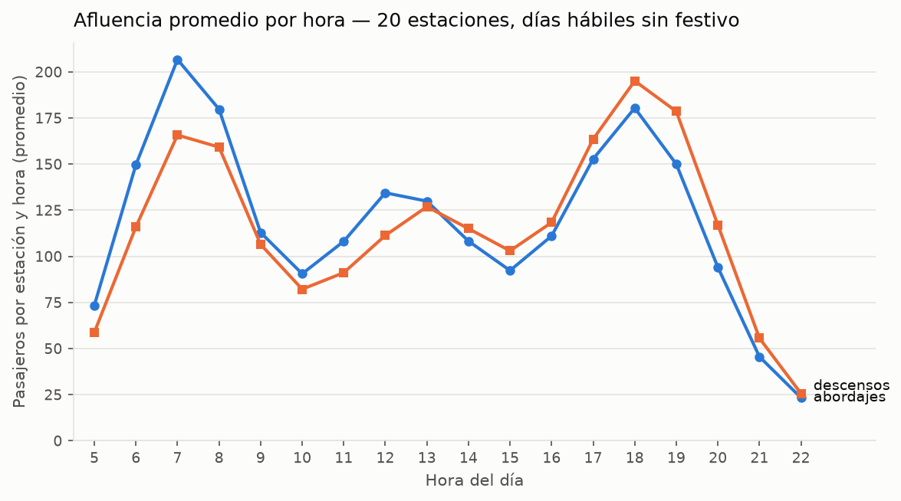
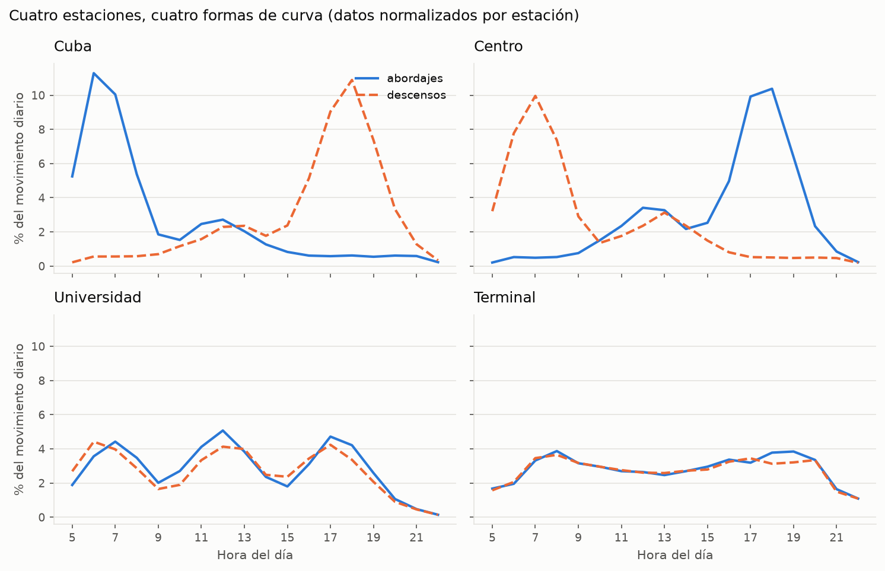
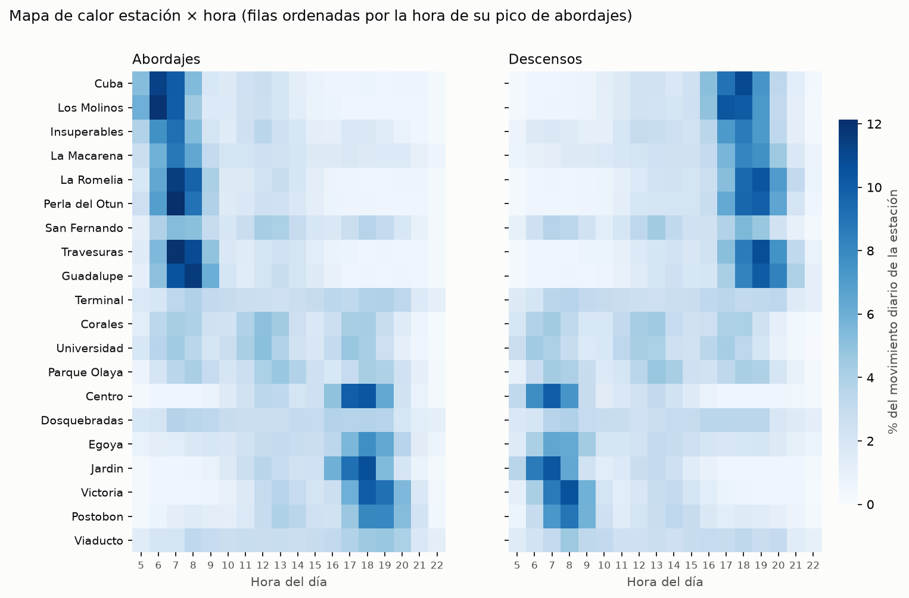

# Descripción de los datos — Afluencia por estación del Megabús

**Actividad 3:** aprendizaje no supervisado (agrupamiento de estaciones)
**Rol A — Datos y preparación**
**Archivos descritos:** `data/afluencia_megabus.csv`, `data/perfiles_reales.csv`, `data/generar_afluencia.py` y `src/cluster/preparacion.py`

Todas las cifras de este documento se obtuvieron ejecutando `py -m src.cluster.ejecutar_todo` sobre los archivos del repositorio.

---

## 1. Objetivo del conjunto de datos

El conjunto registra cuántos pasajeros **suben** (abordajes) y **bajan** (descensos) en cada estación, en cada hora del día. Con esas curvas de demanda se busca descubrir, sin ninguna etiqueta, qué estaciones se comportan de forma parecida.

> **Esta actividad es no supervisada:** `afluencia_megabus.csv` **no tiene columna de respuesta**. Ninguna columna dice de qué tipo es cada estación. El algoritmo debe encontrar los grupos por su cuenta.

---

## 2. Procedencia: datos sintéticos

No existe una fuente pública con conteos de pasajeros por estación y hora del Megabús. Por eso los datos los produjo un programa, `data/generar_afluencia.py`. **No son mediciones reales** ni registros oficiales.

### 2.1 Cómo los genera el programa

1. A cada estación se le asigna un **arquetipo** (residencial, laboral, mixta o intercambio), un **tamaño** (escala de 0,55 a 1,00), un **corrimiento** de sus horas pico (de −0,6 a +0,8 horas) y, en 6 estaciones, una **mezcla** con un segundo arquetipo (18 % a 28 %).
2. Cada arquetipo define una curva con picos en forma de campana:

| Arquetipo | Abordajes (suben) | Descensos (bajan) |
|---|---|---|
| Residencial | Pico ≈ 6:50 | Pico ≈ 18:10 |
| Laboral | Pico ≈ 17:55 | Pico ≈ 7:10 |
| Mixta | Tres picos: mañana, mediodía y tarde | Igual, en ambos sentidos |
| Intercambio | Meseta alta de 7 a 20 h con picos suaves | Igual |

3. A toda estación se le suma un **flujo base** mínimo (0,05 de 6 a 21 h; 0,02 a las 5 y 22 h).
4. El valor se multiplica por factores del día (sábado 0,62; domingo 0,38; festivo 0,44), del clima (nublado 1,03; lluvia 1,14), una variación diaria por estación (±15 %) y ruido por hora (±38 %).
5. Se usa la **semilla 42**, así que el programa produce siempre los mismos datos.

### 2.2 Corrección hecha al generador

El generador recibido **no reproducía** el CSV entregado: le faltaba el flujo base del punto 3. Sin él, aparecían 1.158 horas con 0 descensos y el ARI con k = 4 bajaba de 1,000 a 0,900. Se agregó la función `flujo_base()` y ahora el CSV generado es **idéntico byte a byte** al entregado. El CSV del repositorio no se modificó.

### 2.3 Archivo de validación

`data/perfiles_reales.csv` guarda el arquetipo con que se generó cada estación (20 filas, columnas `estacion`, `arquetipo_real`, `arquetipo_secundario`).

> **Advertencia:** `perfiles_reales.csv` **no se usa como entrada del modelo** ni para construir la matriz. `preparacion.py` ni siquiera lo lee. Solo se compara al final, en `validacion.py`, después de obtener los grupos. Si entrara al modelo, el ejercicio dejaría de ser no supervisado.

---

## 3. Diccionario de datos de `afluencia_megabus.csv`

| Columna | Descripción | Tipo | Valores observados | Distintos | Nulos |
|---|---|---|---|---|---|
| `fecha_dia` | Día simulado | entero | 1 a 30 | 30 | 0 |
| `dia_semana` | Día de la semana (sin tildes) | texto | lunes … domingo; el día 1 es lunes | 7 | 0 |
| `es_festivo` | 1 si el día es festivo | entero (0/1) | 0 o 1; festivos: día 7 (domingo) y día 24 (miércoles) | 2 | 0 |
| `clima` | Clima del día (igual para todas las estaciones) | texto | despejado (15 días), nublado (8), lluvia (7) | 3 | 0 |
| `estacion` | Nombre de la estación | texto | 20 nombres (ver sección 4.3) | 20 | 0 |
| `hora` | Franja horaria (entero, 24 h) | entero | 5 a 22 | 18 | 0 |
| `abordajes` | Pasajeros que suben en esa estación y hora | entero | 1 a 721; media 100,9; mediana 66 | 508 | 0 |
| `descensos` | Pasajeros que bajan en esa estación y hora | entero | 1 a 613; media 98,8; mediana 66 | 486 | 0 |

**No hay columna objetivo.** Ninguna de las 8 columnas indica el tipo de estación.

---

## 4. Calidad de los datos

### 4.1 Comprobaciones

| Comprobación | Resultado |
|---|---|
| Registros | 10.800 = 20 estaciones × 30 días × 18 horas ✔ |
| Valores nulos | 0 en todas las columnas |
| Filas duplicadas | 0 |
| Registros repetidos (mismo día, estación y hora) | 0 |
| Registros por estación | 540 en cada una (30 días × 18 horas) |
| Valores negativos o en cero | 0 (el mínimo es 1 pasajero) |
| `dia_semana`, `es_festivo` y `clima` constantes dentro de cada día | Sí, en los 30 días |

### 4.2 Totales

Abordajes simulados en total: 1.089.269. Descensos: 1.067.401.

### 4.3 Nombres de estación frente a la Actividad 1

La guía pide revisar los nombres contra `kb/estaciones.py`. Resultado de `comparar_con_actividad_1()`:

| Situación | Estaciones |
|---|---|
| Existen en la Actividad 1 (8) | Cuba (*Intercambiador Cuba*), Dosquebradas (*Intercambiador Dosquebradas*), Egoya (*Egoyá*), Jardin (*El Jardín*), Parque Olaya, San Fernando, Victoria, Viaducto |
| Sin equivalente en la Actividad 1 (12) | Centro, Corales, Guadalupe, Insuperables, La Macarena, La Romelia, Los Molinos, Perla del Otun, Postobon, Terminal, Travesuras, Universidad |

**Decisión: no se renombraron.** Razones:

- Las 12 restantes no tienen una estación equivalente en la Actividad 1. Reemplazarlas obligaría a decidir qué estación real es "residencial" o "laboral", y eso sería inventar el uso real de cada estación.
- Cambiar solo 8 nombres dejaría un conjunto a medias, sin ganar coherencia.
- Los resultados de referencia de la guía (y la tabla de grupos) usan estos 20 nombres.
- El nombre es solo una etiqueta: renombrar no cambiaría ningún resultado numérico.

Si el tutor exige nombres de la Actividad 1, basta con cambiar las claves del diccionario `ESTACIONES` del generador y regenerar los dos CSV.

---

## 5. Preparación: de 10.800 registros a una matriz de 20 × 36

La función `preparar_datos()` de `src/cluster/preparacion.py` hace cuatro pasos, siempre en este orden:

| Paso | Qué hace | Resultado |
|---|---|---|
| 1. Filtrar | Deja solo lunes a viernes que **no** son festivos | 21 de 30 días, 7.560 registros |
| 2. Promediar | Promedio de abordajes y descensos por estación y hora | 20 estaciones × 18 horas × 2 medidas |
| 3. Pivotar | Una fila por estación: `ab_05` … `ab_22` y luego `de_05` … `de_22` | **Matriz de 20 × 36** |
| 4. Normalizar | Divide cada fila por su propio total | Cada fila suma 1 |

**Por qué solo días hábiles sin festivo:** los fines de semana y festivos tienen menos pasajeros y no siguen la rutina de ir y volver del trabajo. Mezclarlos borronearía los picos que distinguen a las estaciones. Hay 22 días de lunes a viernes; se quita el miércoles 24, que es festivo.

### 5.1 Normalización por fila

Las estaciones tienen tamaños muy distintos: el movimiento promedio de un día hábil va de 2.183 pasajeros (Guadalupe) a 10.101 (Dosquebradas), **4,6 veces más**. Si no se normaliza, el algoritmo agrupa por tamaño: grandes con grandes, pequeñas con pequeñas.

Al dividir cada fila por su total, cada valor pasa a ser **"qué parte del movimiento diario de la estación ocurre en esa hora"**. Así se compara la **forma** de la curva. Ejemplo: en Cuba, el 11,3 % de su movimiento diario son abordajes de las 6:00.

Si una estación tuviera total 0, el programa se detiene con un mensaje claro en vez de dividir por cero. Con estos datos no ocurre: el mínimo por hora es 1 pasajero.

### 5.2 Normalizar no es lo mismo que estandarizar

| | Normalización por fila (Rol A) | Estandarización por columna (Rol B) |
|---|---|---|
| Dónde | `preparacion.py` | `seleccion_k.py` (`StandardScaler`) |
| Opera sobre | Cada estación (fila) | Cada hora (columna) |
| Deja | Cada fila sumando 1 | Cada columna con media 0 y desviación 1 |
| Para qué | Quitar el tamaño de la estación | Que todas las horas pesen igual en la distancia |

Se aplican en ese orden y en módulos separados.

---

## 6. Gráficas de exploración

Se generan con `py -m src.cluster.exploracion` (o con el flujo completo) en `docs/actividad3/figuras/`.

### 6.1 Curva promedio por hora

En promedio (20 estaciones, días hábiles), los abordajes tienen su pico a las **7:00** (206,7 por estación) y los descensos a las **18:00** (195,1). Hay un repunte menor al mediodía y el mínimo es a las 22:00 (23,3 abordajes). Este promedio mezcla todas las estaciones y esconde que cada una tiene una forma propia.

### 6.2 Cuatro estaciones distintas

Con los datos normalizados se ve a simple vista que las curvas tienen formas diferentes:

- **Cuba:** los abordajes suben en la mañana y los descensos en la tarde.
- **Centro:** es el espejo de Cuba. La gente baja en la mañana y sube en la tarde.
- **Universidad:** tres picos parecidos (mañana, mediodía y tarde) en ambos sentidos.
- **Terminal:** curva casi plana de 7 a 20 h, con subidas y bajadas similares.

Las estaciones se escogieron solo para ilustrar; el algoritmo no recibe esta lista.

### 6.3 Mapa de calor estación × hora

Cada fila es una estación y cada columna una hora. Más oscuro significa mayor porcentaje del movimiento diario. Las filas están ordenadas por la hora de su pico de abordajes, sin usar ninguna etiqueta. Se distinguen bloques: estaciones con abordajes oscuros temprano y descensos oscuros en la tarde, otras con el patrón contrario, y otras de color parejo todo el día.

---

## 7. Limitaciones

1. **Datos sintéticos:** los patrones salen de curvas definidas por el equipo, no del Megabús real.
2. **Arquetipos conocidos de antemano:** el generador parte de 4 tipos; por eso es razonable esperar 4 grupos. Con datos reales no hay garantía de que existan tipos tan limpios.
3. **Nombres de estación:** 12 de 20 no existen en la base de conocimiento de la Actividad 1 (sección 4.3).
4. **Solo 30 días y 21 días hábiles:** no hay estacionalidad, vacaciones ni eventos.
5. **Clima por día:** el mismo clima para todas las estaciones y todas las horas.

Los resultados sirven para practicar y demostrar las técnicas de agrupamiento. **No son una medición oficial de la demanda del Megabús.**
