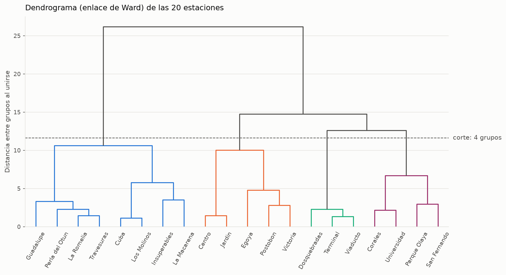
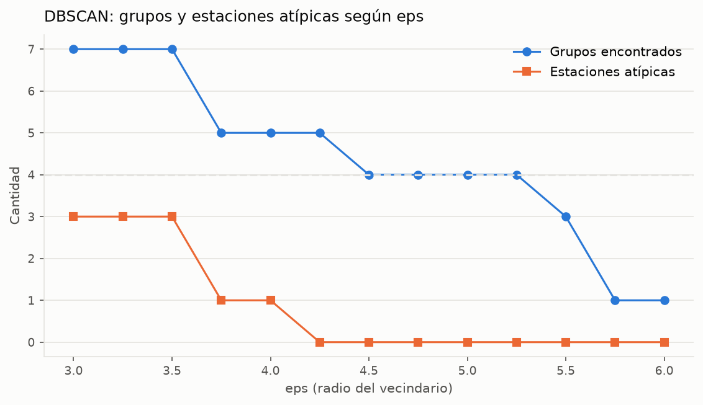
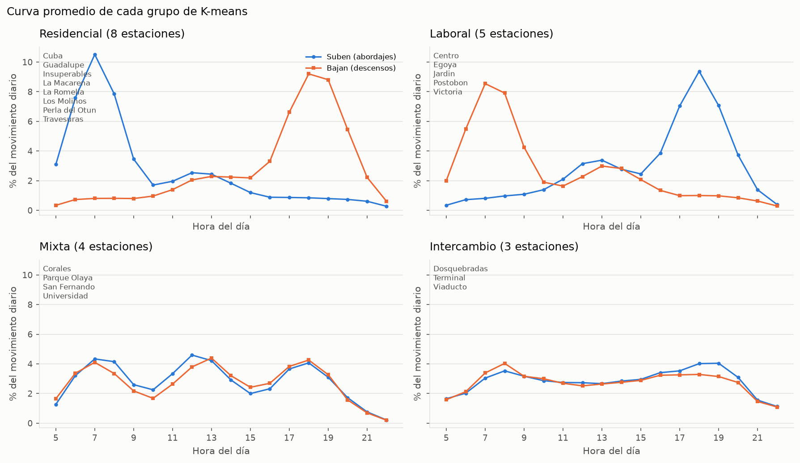

# Documento de pruebas del modelo – Actividad 3

Aprendizaje no supervisado: agrupamiento de las 20 estaciones del Megabús según la forma de su curva de abordajes y descensos.
Este documento es del Rol C: agrupamiento jerárquico, DBSCAN, interpretación de los grupos y validación final.

## Cómo reproducir los resultados

Desde la raíz del repositorio, con el entorno virtual activo:

```
py -m src.cluster.kmeans_modelo        # Rol B: entrena K-means (k = 4)
py -m src.cluster.jerarquico           # Rol C: Ward y dendrograma
py -m src.cluster.validacion           # Rol C: comparación, DBSCAN, nombres y validación final
py -m unittest src.tests.test_cluster_validacion -v
```

Todos los métodos usan la misma entrada: la matriz de 20 estaciones × 36 columnas (18 horas de abordajes + 18 de descensos). Viene de `preparacion.py`, normalizada por fila y estandarizada con `StandardScaler`, igual que en K-means.

> **No se usó ninguna etiqueta.** `data/perfiles_reales.csv` solo se lee en el último paso (sección 4), cuando los grupos ya están formados y tienen nombre.

---

## 1. Segundo método: agrupamiento jerárquico (Ward)

`AgglomerativeClustering(linkage="ward")` arranca con cada estación como un grupo propio y va uniendo, paso a paso, los dos grupos más parecidos. El dendrograma dibuja esas uniones: cuanto más alta es una unión, más distintos eran los grupos que se juntaron.



Si se corta el árbol a una altura de 11,6 (la línea punteada), quedan **4 grupos**. Arriba de ese corte, las uniones son mucho más altas (12,6, 14,7 y 26,2). Eso indica que esos grupos son claramente distintos entre sí.

### K-means contra Ward

| K-means \ Ward | 0 | 1 | 2 | 3 |
|---|---|---|---|---|
| **0** | **8** | 0 | 0 | 0 |
| **1** | 0 | **4** | 0 | 0 |
| **2** | 0 | 0 | 0 | **3** |
| **3** | 0 | 0 | **5** | 0 |

**ARI (`adjusted_rand_score`) = 1,000.**

Cada grupo de K-means cae completo en un único grupo de Ward. Los números no coinciden (el grupo 2 de K-means es el 3 de Ward), pero eso da igual: el número que cada algoritmo le pone a un grupo es arbitrario. El ARI mide si **las mismas estaciones quedaron juntas**, y aquí coinciden todas. Son dos métodos con lógicas distintas (uno parte de 4 centros, el otro une de abajo hacia arriba) que llegan a los mismos grupos, así que los grupos son reales y no un capricho del algoritmo.

---

## 2. Tercer método: DBSCAN

DBSCAN no recibe la cantidad de grupos. Junta las estaciones que tienen vecinas a menos de una distancia `eps`. Las que no tienen ninguna vecina cerca quedan como **atípicas**. Se usó `min_samples = 2` y se varió `eps` entre 3,0 y 6,0.



| eps | Grupos | Atípicas | Cuáles |
|---|---|---|---|
| 3,00 – 3,50 | 7 | 3 | Egoyá, Insuperables, La Macarena |
| 3,75 – 4,00 | 5 | 1 | **Egoyá** |
| 4,25 | 5 | 0 | – |
| **4,50 – 5,25** | **4** | **0** | – |
| 5,50 | 3 | 0 | – |
| 5,75 – 6,00 | 1 | 0 | – |

- **Con `eps` entre 4,5 y 5,25, DBSCAN también encuentra 4 grupos y ninguna estación atípica.** Un tercer método, que ni siquiera sabía cuántos grupos buscar, confirma el resultado.
- **Con `eps = 4,0`, Egoyá queda atípica.** Su curva es laboral (la gente llega en la mañana y se va en la tarde), pero más suave que la del resto de ese grupo:

  | | Baja en la mañana | Sube en la tarde | Variación hora a hora |
  |---|---|---|---|
  | Egoyá | 16,8 % | 19,7 % | 0,387 |
  | Resto del grupo laboral | 23,2 % | 24,4 % | 0,485 |
  | Grupo de intercambio | 9,5 % | 11,6 % | 0,266 |

  Egoyá queda **a mitad de camino entre una estación laboral y una de intercambio**. K-means y Ward la ponen en el grupo laboral, que es el más cercano, pero DBSCAN detecta que está lejos del centro de ese grupo.

---

## 3. Interpretación: ¿qué es cada grupo?

`validacion.py` calcula la curva promedio de cada grupo y le pone nombre con una regla que solo mira la forma de esa curva:

| Regla | Nombre |
|---|---|
| El grupo donde, en la mañana (6:00 – 8:59), más gente **sube** que baja | **Residencial**: la gente sale de su casa |
| El grupo donde, en la mañana, más gente **baja** que sube | **Laboral**: la gente llega a trabajar |
| De los que quedan, el de movimiento más **parejo** durante el día | **Intercambio** |
| El que queda | **Mixta** |



| Grupo | Estaciones | Sube en la mañana | Baja en la mañana | Sube en la tarde | Baja en la tarde | Mediodía | Variación |
|---|---|---|---|---|---|---|---|
| **Residencial** | Cuba, Guadalupe, Insuperables, La Macarena, La Romelia, Los Molinos, Perla del Otún, Travesuras | **25,9 %** | 2,3 % | 2,5 % | **24,6 %** | 12,7 % | 0,520 |
| **Laboral** | Centro, Egoyá, Jardín, Postobón, Victoria | 2,5 % | **21,9 %** | **23,5 %** | 3,0 % | 15,5 % | 0,463 |
| **Mixta** | Corales, Parque Olaya, San Fernando, Universidad | 11,7 % | 10,8 % | 10,8 % | 11,4 % | **23,0 %** | 0,431 |
| **Intercambio** | Dosquebradas, Terminal, Viaducto | 8,6 % | 9,5 % | 11,6 % | 9,7 % | 16,0 % | **0,266** |

*(Porcentajes del movimiento diario total de cada grupo.)*

- **Residencial y laboral son espejos.** En las residenciales, el 26 % del movimiento del día es gente que sube en la mañana y el 25 % gente que baja en la tarde. En las laborales es exactamente al revés.
- **Mixta** tiene flujo en los dos sentidos y el mayor repunte al mediodía (23 %): universidades y zonas de comercio.
- **Intercambio** es la curva más plana (variación de 0,266, la mitad que la residencial): hay movimiento alto y parejo todo el día, como en las terminales.

Los nombres salen de la regla. No se tomaron de `perfiles_reales.csv`, que todavía no se ha leído.

---

## 4. Validación final contra los tipos reales

Recién ahora se lee `data/perfiles_reales.csv`, con el tipo con el que se generó cada estación.

| Tipo real \ Nombre del grupo | Residencial | Laboral | Mixta | Intercambio |
|---|---|---|---|---|
| **Residencial** | **8** | 0 | 0 | 0 |
| **Laboral** | 0 | **5** | 0 | 0 |
| **Mixta** | 0 | 0 | **4** | 0 |
| **Intercambio** | 0 | 0 | 0 | **3** |

> **20 de 20 estaciones bien nombradas. ARI = 1,000.**

El algoritmo no sabía que existían barrios residenciales y zonas de trabajo. Lo dedujo solo, mirando a qué horas sube y baja la gente.

### Las estaciones atípicas de DBSCAN tenían una razón

`perfiles_reales.csv` también trae un tipo **secundario** para algunas estaciones. Son justo las que DBSCAN marcó como atípicas con `eps` bajo:

| Estación | Tipo real | Tipo secundario | DBSCAN |
|---|---|---|---|
| Egoyá | laboral | intercambio | atípica hasta `eps = 4,0` |
| Insuperables | residencial | mixta | atípica hasta `eps = 3,5` |
| La Macarena | residencial | intercambio | atípica hasta `eps = 3,5` |

DBSCAN detectó, sin ninguna etiqueta, que estas tres estaciones tienen un comportamiento **mezclado**.

### La trampa de la silueta: ¿por qué k = 4?

El Rol B probó K-means con k de 2 a 8. A su tabla se le agrega aquí una columna: qué tanto coinciden los grupos con los tipos reales.

| k | Inercia (Rol B) | Silueta (Rol B) | ARI contra los tipos reales |
|---|---|---|---|
| 2 | 376,8 | 0,404 | 0,503 |
| 3 | 268,0 | 0,375 | 0,844 |
| **4** | **188,5** | **0,447** | **1,000** |
| 5 | 132,0 | 0,446 | 0,745 |
| 6 | 81,8 | 0,510 | 0,631 |
| 7 | 59,5 | 0,518 | 0,549 |
| 8 | 42,9 | **0,527** | 0,460 |

- **La silueta más alta está en k = 8, no en k = 4.** Con solo 20 estaciones, la silueta premia partir los grupos en pedazos cada vez más chicos. Si se eligiera k solo por ese número, se elegiría mal: con k = 8 el ARI baja a 0,460, porque quedan grupos partidos que no corresponden a ningún tipo real.
- **k = 4 se justifica con varios criterios a la vez:**
  - la silueta tiene un máximo local en k = 4 (sube de 0,375 a 0,447 y en k = 5 ya no mejora);
  - el dendrograma tiene un salto claro de altura en 4 grupos;
  - DBSCAN encuentra 4 grupos sin que se lo pidan;
  - los 4 grupos tienen una interpretación clara.
- **El ARI contra los tipos reales confirma la elección** (1,000), pero no se usó para elegir k. Con datos reales no tendríamos esa columna.

---

## 5. Pruebas automáticas

[`src/tests/test_cluster_validacion.py`](../../src/tests/test_cluster_validacion.py) tiene **8 pruebas**. Usan 12 estaciones inventadas (3 de cada tipo), así que la respuesta correcta se conoce de antemano.

| Prueba | Qué comprueba |
|---|---|
| `test_ward_separa_los_cuatro_tipos` | Ward encuentra los 4 tipos (ARI = 1). |
| `test_matriz_de_enlace_para_el_dendrograma` | El dendrograma tiene una unión menos que estaciones. |
| `test_mismos_grupos_con_otros_numeros_dan_ari_1` | El ARI no depende del número que se le pone a cada grupo. |
| `test_tabla_cruzada` | La tabla cruzada cuenta bien. Si los grupos difieren, el ARI baja. |
| `test_barrido_cuenta_grupos_y_atipicas` | DBSCAN: con `eps` diminuto todas las estaciones son atípicas; con `eps` enorme, todas forman un solo grupo. |
| `test_describir_grupos` | El grupo residencial sube más de lo que baja en la mañana. El de intercambio es el más parejo. |
| `test_nombra_cada_grupo_por_la_forma_de_su_curva` | La regla pone el nombre correcto a cada grupo, aunque los números de grupo sean arbitrarios. |
| `test_validar_contra_los_tipos_reales` | La validación cuenta 12 de 12 aciertos y ningún error. |

```
py -m unittest src.tests.test_cluster_validacion -v
Ran 8 tests ... OK
```

---

## 6. Limitaciones

- **Los datos son sintéticos.** Los cuatro tipos de estación los definió el generador (`data/generar_afluencia.py`). Que el agrupamiento los recupere al 100 % muestra que el método funciona, pero con datos reales los grupos serían menos limpios.
- **La validación del punto 4 solo es posible porque los datos son sintéticos.** Con datos reales no existiría `perfiles_reales.csv`. Por eso k se eligió con los criterios internos (silueta, codo, dendrograma y DBSCAN) y no con el ARI.
- **La regla de los nombres supone 4 grupos con estos tipos de comportamiento.** Con otro k habría que revisar las curvas a mano.
- **Con 20 estaciones, cada estación pesa mucho.** Por eso la silueta es engañosa y DBSCAN es sensible al valor de `eps`.
