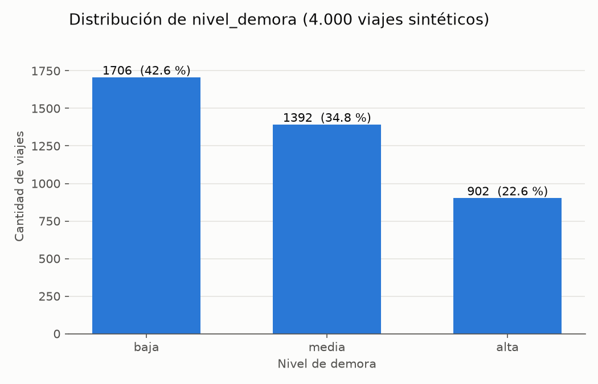
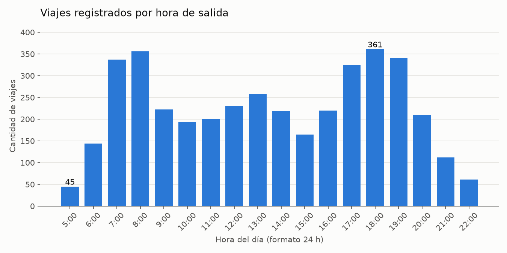
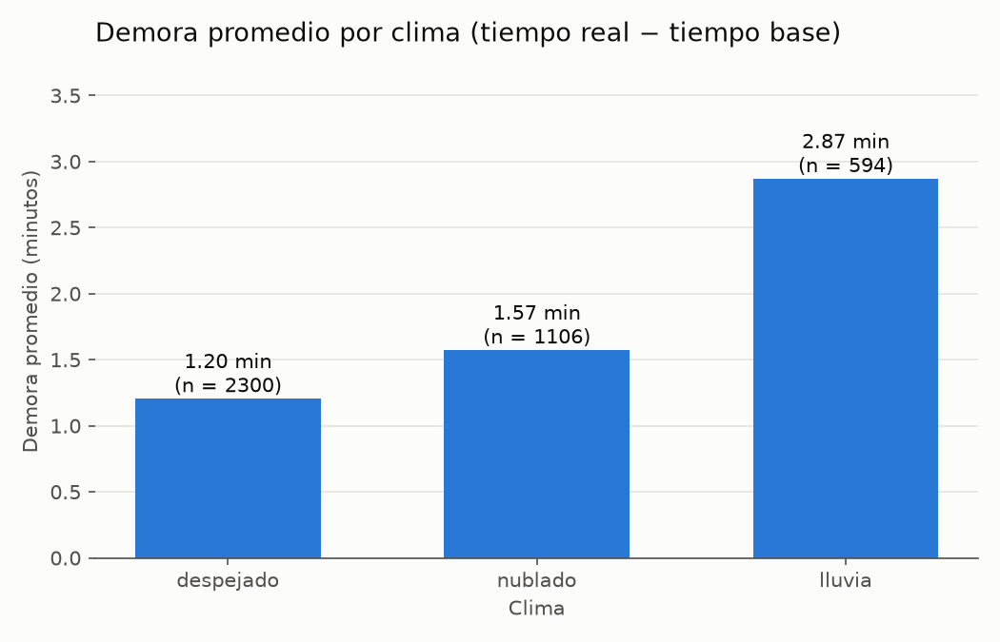

# Descripción de los datos — Viajes del sistema Megabús

**Proyecto:** Aprendizaje supervisado con árbol de decisión sobre los viajes del Megabús (Pereira – Dosquebradas)
**Rol A — Los datos**
**Archivos descritos:** `data/viajes_megabus.csv` (datos) y `data/generar_dataset.py` (generador)

---

## 1. Introducción y objetivo

Este documento describe el conjunto de datos con el que se entrena el árbol de decisión que predice el **nivel de demora** de un viaje (`baja`, `media` o `alta`). Explica de dónde salen los datos, cómo se generaron, qué significa cada columna, qué calidad tienen y qué columnas pueden usarse para entrenar.

Todas las cifras de este documento se obtuvieron ejecutando `data/analizar_datos.py` sobre el CSV entregado. Si el CSV se regenera con otra semilla o con otros parámetros, las cifras deben recalcularse.

> **Advertencia principal:** los datos son **sintéticos**. No son registros reales del Megabús. Sirven para practicar y demostrar la técnica de aprendizaje, no para sacar conclusiones sobre la operación real del sistema.

---

## 2. Descripción general del conjunto de datos

| Característica | Valor |
|---|---|
| Archivo | `data/viajes_megabus.csv` |
| Codificación | UTF-8, separado por comas, con encabezado |
| Filas (viajes) | 4.000 |
| Columnas | 13 |
| Valores nulos | 0 en todas las columnas |
| Filas duplicadas completas | 0 |
| `id_viaje` repetidos | 0 |
| Variable objetivo | `nivel_demora` |
| Semilla aleatoria | 42 |

Cada fila representa **un viaje simulado** entre dos estaciones del sistema, con su hora, día, clima, tiempos y nivel de demora.

---

## 3. Procedencia y naturaleza sintética de los datos

### 3.1 ¿Qué significa que los datos sean sintéticos?

Significa que **ningún viaje fue medido en la realidad**. Los 4.000 registros los produjo un programa (`data/generar_dataset.py`) combinando:

- **Hechos tomados de la Actividad 1:** los nombres y coordenadas de las 37 estaciones y las rutas que pasan por cada una (`kb/estaciones.py` y `kb/conexiones.py`).
- **Selecciones aleatorias** con probabilidades fijadas por el equipo (estaciones, hora, día, festivo, clima).
- **Fórmulas y reglas escritas por el equipo** para calcular los tiempos y la etiqueta.
- **Ruido intencional** que altera algunas etiquetas.

### 3.2 ¿Por qué se usan datos sintéticos?

No existe un archivo público con los tiempos de viaje por trayecto del Megabús. El enunciado de la actividad contempla este caso y autoriza construir una muestra propia. Por eso el generador se apoya en el grafo de estaciones ya construido en la Actividad 1. **No se consultaron registros oficiales ni se hicieron mediciones de campo.**

### 3.3 Cómo construye el generador cada registro

El programa repite 4.000 veces los siguientes pasos (función `generar()`):

| Paso | Columna | Mecanismo | Detalle en el código |
|---|---|---|---|
| 1 | `estacion_origen` | Aleatorio uniforme | `random.choice` entre las 37 estaciones de `ESTACIONES`. |
| 2 | `estacion_destino` | Aleatorio uniforme | `random.choice` entre las 36 restantes (nunca igual al origen). |
| 3 | `distancia_km` | Cálculo | Fórmula de Haversine (línea recta) con las coordenadas de la Actividad 1. |
| 4 | `ruta`, `num_transbordos` | Regla + aleatorio | Función `ruta_de()`: si alguna ruta (R1, R2, R3) pasa por las dos estaciones, se elige una de ellas al azar y hay **0 transbordos**; si no, se sale por una ruta del origen y hay **1 transbordo**. |
| 5 | `hora` | Aleatorio con pesos | `random.choices` entre 5 y 22 con pesos fijos que favorecen las horas pico (ver sección 7.2). |
| 6 | `dia_semana` | Aleatorio uniforme | Lunes a domingo, misma probabilidad. |
| 7 | `es_festivo` | Aleatorio | 1 con probabilidad del 7 %, independiente del día. |
| 8 | `clima` | Aleatorio con pesos | despejado 58 %, nublado 27 %, lluvia 15 %. |
| 9 | `tiempo_base_min` | Cálculo | `distancia / 21 km/h × 60 + 5 min por transbordo`, con un mínimo de 3 minutos. |
| 10 | `tiempo_real_min` | Cálculo | `tiempo_base × factor_hora × factor_dia × factor_clima`. |
| 11 | `nivel_demora` | Regla + ruido | Regla de umbrales sobre la demora; luego, con probabilidad 12 %, se cambia por otra etiqueta al azar. |
| — | `id_viaje` | Contador | Número consecutivo de 1 a 4.000. |

### 3.4 Factores que multiplican el tiempo base

| Factor | Condición | Valor |
|---|---|---|
| `factor_hora` | 6 a 8 h (pico mañana) | 1,45 |
| | 17 a 19 h (pico tarde) | 1,40 |
| | 11 a 13 h (mediodía) | 1,15 |
| | 5 h o 21 a 22 h (madrugada / noche) | 0,90 |
| | resto de horas | 1,00 |
| `factor_dia` | festivo (cualquier día) | 0,82 |
| | domingo | 0,78 |
| | sábado | 0,90 |
| | lunes a viernes | 1,00 |
| `factor_clima` | despejado | 1,00 |
| | nublado | 1,04 |
| | lluvia | 1,22 |

Como algunos factores son menores que 1, el tiempo real puede ser **menor** que el base (por ejemplo, un domingo en la noche). En el CSV hay **695 viajes** con demora negativa, es decir, viajes que llegan antes de lo previsto.

### 3.5 Cómo se determina `nivel_demora`

La función `etiquetar()` calcula los minutos de más:

```
demora = tiempo_base × factor_total − tiempo_base   (equivale a tiempo_real − tiempo_base)
```

| Demora (minutos) | Etiqueta |
|---|---|
| menor que 0,8 | `baja` |
| de 0,8 a menos de 3,2 | `media` |
| 3,2 o más | `alta` |

Después, con probabilidad del **12 %** la etiqueta se reemplaza por una de las otras dos al azar. En el CSV entregado el ruido afectó **496 viajes (12,4 %)**. El ruido representa incidentes que el modelo no puede conocer (averías, desvíos, eventos) y evita que el árbol llegue a un 100 % de acierto, lo que sería irreal.

### 3.6 La semilla aleatoria

El generador llama a `random.seed(42)` antes de producir los datos. Con la misma semilla, el programa produce **exactamente el mismo CSV** cada vez que se ejecuta. Esto se comprobó generando el archivo dos veces (incluso con distinta configuración de Python) y comparando ambos byte a byte: son idénticos. Gracias a esto, cualquier integrante o el tutor puede reproducir los datos y verificar los resultados del modelo.

### 3.7 Protección contra sobrescritura

El generador guarda por defecto en `data/viajes_megabus.csv`. Si ese archivo ya existe, **no lo reemplaza** a menos que se use la opción `--sobrescribir`. Para hacer pruebas sin tocar el archivo oficial se puede usar `--salida data/prueba.csv`.

---

## 4. Revisión de las estaciones frente a la Actividad 1

### 4.1 Problema encontrado en la versión 1

La primera versión del generador usaba 20 estaciones propias. Al compararlas con `kb/estaciones.py` de la Actividad 1 se encontró lo siguiente:

| Situación | Estaciones de la versión 1 |
|---|---|
| Coinciden exactamente | San Fernando, Parque Olaya, Victoria, Viaducto |
| Coinciden con otra escritura | Cuba (*Intercambiador Cuba*), Dosquebradas (*Intercambiador Dosquebradas*), Egoya (*Egoyá*, faltaba la tilde) |
| No existen en la Actividad 1 | Perla del Otun, Travesuras, Insuperables, Corales, Universidad, Jardin, Centro, Postobon, La Macarena, La Romelia, Los Molinos, Guadalupe, Terminal |

Además, las coordenadas no coincidían con las de la Actividad 1, y la lógica de rutas asignaba la **Ruta 3** a viajes hacia Dosquebradas, cuando en la Actividad 1 la Ruta 3 es un circuito Cuba – Centro que no llega a Dosquebradas.

### 4.2 Corrección aplicada (versión 2)

- Se reemplazaron las 20 estaciones por las **37 estaciones de la Actividad 1**, con los mismos nombres (incluidas tildes) y coordenadas.
- Cada estación lleva las rutas que pasan por ella según `kb/conexiones.py`; la ruta y los transbordos se calculan a partir de ellas.
- **No se modificaron** la regla de `nivel_demora`, los factores, los pesos ni la velocidad.

### 4.3 Verificación

`data/analizar_datos.py` compara el CSV y el generador con `kb/estaciones.py`. Resultado de la ejecución:

- Estaciones distintas en el CSV: **37**; en la Actividad 1: **37**.
- Estaciones del CSV que no están en la Actividad 1: **ninguna**.
- Estaciones de la Actividad 1 que no aparecen en el CSV: **ninguna**.
- Coordenadas distintas entre el generador y `kb/`: **ninguna**.

### 4.4 Respaldo de los datos anteriores

El CSV de la versión 1 se conserva en `data/respaldo/viajes_megabus_v1_original.csv` (4.000 filas, 13 columnas, sin nulos). Comparación:

| | Versión 1 (respaldo) | Versión 2 (oficial) |
|---|---|---|
| Estaciones | 20 (13 no existen en la Actividad 1) | 37 (todas de la Actividad 1) |
| baja / media / alta | 43,0 % / 31,9 % / 25,1 % | 42,6 % / 34,8 % / 22,6 % |
| Etiquetas con ruido | 518 (13,0 %) | 496 (12,4 %) |

> **Importante para los roles B y C:** cualquier resultado calculado con la versión 1 (por ejemplo, la línea base del 43 % o el acierto del árbol) debe recalcularse con la versión 2.

---

## 5. Diccionario de datos

Clasificación usada: **Identificador**, **Predictora** (puede usarse para entrenar), **Objetivo** (lo que se predice), **Excluir** (no debe usarse para entrenar).

| # | Columna | Descripción | Tipo | Ejemplos observados | Valores posibles / rango observado | Distintos | Nulos | Utilidad | Clasificación |
|---|---|---|---|---|---|---|---|---|---|
| 1 | `id_viaje` | Número consecutivo del viaje | entero | 1, 2, 3 | 1 a 4.000 | 4.000 | 0 | Identificar filas | Identificador (excluir) |
| 2 | `estacion_origen` | Estación donde empieza el viaje | texto | Ucumarí, Maraya, Fundadores | Las 37 estaciones de la Actividad 1 | 37 | 0 | Ubicación de salida | Predictora |
| 3 | `estacion_destino` | Estación donde termina el viaje (distinta del origen) | texto | San Fernando, Banderas, Cañarte | Las 37 estaciones de la Actividad 1 | 37 | 0 | Ubicación de llegada | Predictora |
| 4 | `ruta` | Ruta troncal por la que sale el viaje | texto | Ruta 1, Ruta 2 | Ruta 1, Ruta 2, Ruta 3 | 3 | 0 | Recorrido usado | Predictora |
| 5 | `num_transbordos` | Cambios de ruta necesarios | entero | 0, 1 | 0 o 1 | 2 | 0 | Suma 5 min al tiempo base | Predictora |
| 6 | `distancia_km` | Distancia en línea recta entre origen y destino | decimal | 3.884, 0.992, 3.209 | 0,02 a 8,59 km | 561 | 0 | Base del tiempo de viaje | Predictora |
| 7 | `hora` | Hora de salida (entero, formato 24 h) | entero | 9, 6, 13 | 5 a 22 | 18 | 0 | Define la franja de congestión | Predictora |
| 8 | `dia_semana` | Día de la semana (sin tildes) | texto | martes, miercoles | lunes, martes, miercoles, jueves, viernes, sabado, domingo | 7 | 0 | Fin de semana reduce el tiempo | Predictora |
| 9 | `es_festivo` | 1 si el día es festivo, 0 si no | entero (0/1) | 0, 1 | 0 o 1 | 2 | 0 | Festivo reduce el tiempo | Predictora |
| 10 | `clima` | Condición del clima | texto | nublado, despejado | despejado, nublado, lluvia | 3 | 0 | La lluvia aumenta el tiempo | Predictora |
| 11 | `tiempo_base_min` | Minutos del trayecto sin congestión | decimal | 11.1, 3.0, 9.17 | 3,00 a 24,54 min | 417 | 0 | Referencia para medir la demora; se conoce antes del viaje | Predictora |
| 12 | `tiempo_real_min` | Minutos con congestión, día y clima aplicados | decimal | 11.54, 4.52, 10.55 | 2,11 a 41,30 min | 1.409 | 0 | Análisis descriptivo y cálculo de la demora | **Excluir** (fuga de información) |
| 13 | `nivel_demora` | Categoría de la demora | texto | baja, media | baja, media, alta | 3 | 0 | Lo que el modelo debe predecir | **Objetivo** |

**Nota sobre valores observados y posibles:** para las columnas de texto se listan todas las categorías encontradas en el CSV; coinciden con las que el generador puede producir. Para las numéricas se informa el rango observado: otro CSV generado con otra semilla podría tener mínimos y máximos un poco distintos.

---

## 6. Estadísticas descriptivas y calidad de los datos

### 6.1 Variables numéricas

| Estadístico | `distancia_km` | `hora` | `tiempo_base_min` | `tiempo_real_min` |
|---|---|---|---|---|
| Mínimo | 0,02 | 5 | 3,00 | 2,11 |
| Percentil 25 | 0,84 | 9 | 3,42 | 4,37 |
| Mediana | 1,75 | 14 | 7,22 | 8,38 |
| Media | 2,27 | 13,50 | 7,75 | 9,30 |
| Percentil 75 | 3,48 | 18 | 10,42 | 12,29 |
| Máximo | 8,59 | 22 | 24,54 | 41,30 |
| Desviación estándar | 1,73 | 4,69 | 4,30 | 5,61 |

La demora calculada (`tiempo_real_min − tiempo_base_min`) va de **−6,38 a 17,96 minutos**, con media de **1,55** y mediana de **1,16**.

### 6.2 Variables categóricas (conteos)

| Columna | Conteos |
|---|---|
| `ruta` | Ruta 1: 1.184 · Ruta 2: 1.614 · Ruta 3: 1.202 |
| `num_transbordos` | 0: 3.244 · 1: 756 |
| `dia_semana` | lunes 554 · martes 573 · miercoles 543 · jueves 614 · viernes 575 · sabado 576 · domingo 565 |
| `es_festivo` | 0: 3.746 · 1: 254 |
| `clima` | despejado 2.300 · nublado 1.106 · lluvia 594 |
| `nivel_demora` | baja 1.706 · media 1.392 · alta 902 |

Cada estación aparece entre 78 y 133 veces como origen y entre 86 y 138 veces como destino.

### 6.3 Calidad

| Comprobación | Resultado |
|---|---|
| Valores nulos | 0 en las 13 columnas |
| Filas completamente duplicadas | 0 |
| `id_viaje` repetidos | 0 |
| Viajes iguales en todo salvo `id_viaje` | 7 (se conservan: dos viajes distintos pueden tener las mismas características) |
| Origen igual a destino | 0 |
| Distancias ≤ 0, horas fuera de 0–23, tiempos ≤ 0 | 0 |
| Tiempo base menor que el mínimo de 3 min | 0 |

No fue necesario limpiar ni eliminar registros.

### 6.4 Coherencia entre tiempos y `nivel_demora`

Aplicando la regla de la sección 3.5 a `tiempo_real_min − tiempo_base_min`, se reproduce la etiqueta en **3.503 de 4.000 viajes (87,6 %)**. Las **497** filas que no coinciden se explican por las 496 etiquetas alteradas por el ruido y por unas pocas filas cuya demora cae justo en un umbral y cambia al redondear los tiempos a dos decimales. Esto confirma que el CSV corresponde a la lógica del generador.

---

## 7. Gráficas e interpretación

Las tres gráficas se generan con Matplotlib ejecutando `py data/analizar_datos.py` y se guardan en `docs/figuras/`.

### 7.1 Distribución de `nivel_demora`



| Nivel | Viajes | Porcentaje |
|---|---|---|
| baja | 1.706 | 42,6 % |
| media | 1.392 | 34,8 % |
| alta | 902 | 22,6 % |

**Interpretación:** las tres clases están presentes y ninguna es extremadamente minoritaria; la clase `alta` es la menor (22,6 %) y `baja` la mayor (42,6 %). El desbalance es moderado, por lo que no se consideró necesario sobremuestrear. Un modelo que siempre respondiera `baja` acertaría alrededor del 42,6 %: esa es la referencia mínima que el árbol debe superar.

### 7.2 Viajes por hora del día



La columna `hora` es un **entero** de 5 a 22 (no tiene minutos), así que se agrupó directamente por su valor y se ordenó de menor a mayor.

**Interpretación:** la hora con más registros es las **18:00 (361 viajes)**, seguida de las 8:00 (356) y las 19:00 (341). La de menos registros es las **5:00 (45 viajes)**, seguida de las 22:00 (61). Se ven dos picos, en la mañana (7–8 h) y en la tarde (17–19 h).

**Precaución:** esta forma la impone el generador, que elige la hora con pesos fijos que favorecen las horas pico. La gráfica muestra **cuántos registros sintéticos hay por hora**, no la demanda real de pasajeros ni la frecuencia real de los buses del Megabús.

### 7.3 Demora promedio por clima



La demora se define como `tiempo_real_min − tiempo_base_min`, que es exactamente la cantidad que usa el generador para asignar `nivel_demora`. No se usa el tiempo total del viaje, porque un viaje largo tendría más minutos aunque no tuviera demora.

| Clima | Viajes | Demora promedio |
|---|---|---|
| despejado | 2.300 | 1,20 min |
| nublado | 1.106 | 1,57 min |
| lluvia | 594 | 2,87 min |

No hay datos faltantes que afecten el cálculo.

**Interpretación:** los viajes con lluvia tienen en promedio más del doble de demora que los de clima despejado. Esta diferencia **no demuestra que la lluvia cause demoras en el Megabús real**: en este conjunto aparece porque el generador multiplica el tiempo por 1,22 cuando llueve. Además, el promedio mezcla otros factores (hora, día, distancia) que varían entre los grupos.

Usar `tiempo_real_min` para esta gráfica es correcto porque es un **análisis descriptivo**. Eso no significa que deba usarse para entrenar el modelo (ver sección 8).

---

## 8. Por qué `tiempo_real_min` no se usa para entrenar

### 8.1 Qué contiene

`tiempo_real_min` es el tiempo base multiplicado por los factores de hora, día y clima. En la práctica es un dato que **solo se conoce cuando el viaje ya terminó**.

### 8.2 Cómo se relaciona con la variable objetivo

La etiqueta se calcula a partir de la diferencia `tiempo_real_min − tiempo_base_min` (sección 3.5). Con esas dos columnas, una simple regla de tres umbrales reproduce `nivel_demora` en el **87,6 %** de los viajes; el resto es ruido que nadie puede predecir.

### 8.3 Por qué produce fuga de información

Si el modelo recibe `tiempo_real_min` como entrada, no necesita aprender nada sobre horas, días o clima: le basta con restar y comparar contra los umbrales. Esto se llama **fuga de información (data leakage)**: una columna de entrada contiene, casi directamente, la respuesta. El modelo parecería excelente en las pruebas, pero sería inútil en la práctica, porque cuando alguien quiere saber si su viaje se va a demorar **todavía no conoce el tiempo real**.

### 8.4 Decisión

`tiempo_real_min` se **excluye** de las variables predictoras del entrenamiento. Sí se conserva en el CSV porque es necesaria para:

- calcular la demora y verificar la coherencia de las etiquetas (sección 6.4);
- construir la gráfica de demora por clima (sección 7.3);
- describir los datos en este documento.

**Analizar con una columna no es lo mismo que entrenar con ella.**

### 8.5 Otras columnas revisadas

| Columna | ¿Riesgo de fuga? | Decisión |
|---|---|---|
| `id_viaje` | No contiene información del viaje; es solo un contador | Excluir |
| Demora calculada (`tiempo_real − tiempo_base`) | Es la base directa de la etiqueta | No crearla como columna de entrada |
| `tiempo_base_min` | No: depende solo de la distancia y los transbordos, que se conocen antes de viajar | Puede usarse |
| `distancia_km`, `num_transbordos`, `ruta`, estaciones | No: se conocen antes de viajar | Pueden usarse |
| `hora`, `dia_semana`, `es_festivo`, `clima` | No: se conocen antes de viajar y son justo lo que el modelo debe aprender | Pueden usarse |

**Variables predictoras recomendadas:** `estacion_origen`, `estacion_destino`, `ruta`, `num_transbordos`, `distancia_km`, `hora`, `dia_semana`, `es_festivo`, `clima`, `tiempo_base_min`.

---

## 9. Limitaciones del conjunto de datos

1. **Datos sintéticos:** los patrones reflejan las reglas que escribió el equipo, no el comportamiento real del Megabús. El árbol puede, como mucho, redescubrir esas reglas.
2. **Distancia en línea recta:** la distancia no sigue el recorrido real del bus por las calles.
3. **Velocidad constante supuesta:** 21 km/h para todos los tramos, sin datos que la respalden para cada tramo.
4. **Dirección de las rutas ignorada:** en el centro, las Rutas 2 y 3 van por calles distintas según el sentido; el generador no lo distingue.
5. **Factores fijos y multiplicativos:** hora, día y clima se combinan siempre de la misma forma; no hay interacciones como lluvia en hora pico más fuerte de lo normal.
6. **Festivo independiente del día:** puede marcar como festivo cualquier día, y en ese caso su factor reemplaza al del fin de semana.
7. **Horas enteras:** la hora no tiene minutos, así que no se distingue 7:05 de 7:55.
8. **Coordenadas aproximadas:** heredan la precisión de la Actividad 1, donde se marcaron como aproximadas.
9. **Ruido uniforme:** el 12 % de ruido cambia etiquetas al azar; los incidentes reales no se distribuyen así.

**Lo que sí se puede concluir:** que el árbol de decisión es capaz de descubrir reglas a partir de datos con estructura y ruido, y que las variables de hora, día, clima y trayecto contienen información para predecir la demora **dentro de este conjunto sintético**.

**Lo que no se puede concluir:** cuánto se demora realmente el Megabús, en qué horas viaja más gente o cuánto afecta la lluvia al servicio real.

---

## 10. Conclusiones del análisis exploratorio

- El CSV tiene 4.000 viajes y 13 columnas, sin nulos, sin duplicados ni valores inválidos.
- Las 37 estaciones coinciden con las de la Actividad 1 después de corregir el generador; la versión anterior se conserva como respaldo.
- La variable objetivo está moderadamente balanceada (42,6 % / 34,8 % / 22,6 %), y la referencia mínima de acierto es cercana al 42,6 %.
- Las etiquetas son coherentes con la lógica del generador: la regla de umbrales las reproduce en el 87,6 % de los casos y el resto corresponde al ruido intencional.
- Los registros se concentran en las horas pico y la demora promedio es mayor con lluvia, ambos efectos programados en el generador.
- `tiempo_real_min` y cualquier demora derivada de él deben quedar fuera del entrenamiento para evitar fuga de información.

---

## 11. Cómo reproducir este análisis

Desde la raíz del repositorio (en Windows, con `py`; en Mac/Linux, con `python3`):

```
pip install pandas matplotlib            # solo la primera vez
py data/analizar_datos.py                # revisa el CSV y regenera las 3 gráficas
py data/generar_dataset.py --salida data/prueba.csv   # genera una copia para comprobar la semilla
```

El último comando produce los mismos conteos que el CSV oficial (baja 1.706, media 1.392, alta 902).
