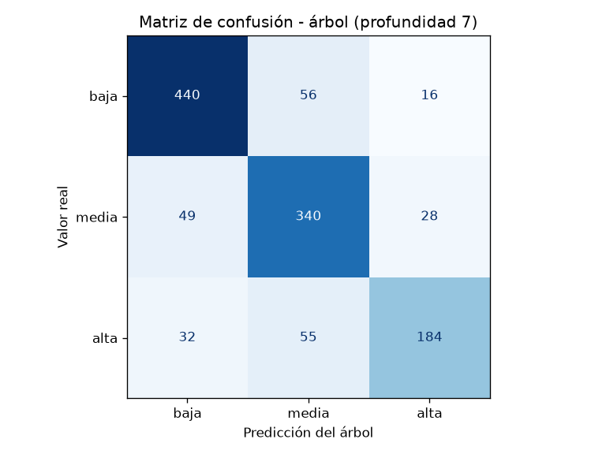
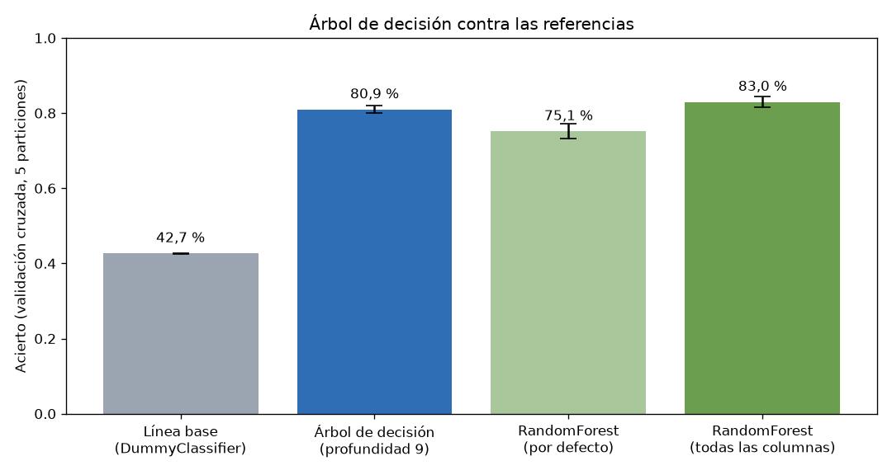

# Documento de pruebas del modelo

Actividad 2: aprendizaje supervisado con un árbol de decisión sobre los datos del Megabús.
Rol C: evaluación del modelo e integración con el motor de inferencia de la Actividad 1.

## Cómo reproducir los resultados

Desde la raíz del repositorio:

```
pip install pandas scikit-learn matplotlib
python src/ml/extraer_reglas.py      # Rol B: entrena el árbol y crea docs/reglas_aprendidas.txt
python src/ml/evaluacion.py          # Rol C: métricas, validación cruzada, comparación e integración
python -m unittest discover -s src/tests -t src     # pruebas automáticas (sin scikit-learn)
```

Los resultados se pueden repetir porque todo usa la semilla `42`. El árbol tiene `criterion="entropy"` y `max_depth=9`, como lo dejó el Rol B. Los datos se reparten así:

| Conjunto | Viajes |
|---|---|
| Entrenamiento (70 %, estratificado) | 2.800 |
| Prueba (30 %, estratificado) | 1.200 |
| Columnas después de `get_dummies()` | 92 |

`id_viaje` y `tiempo_real_min` no entran al modelo. La segunda columna delata la respuesta: ver [descripcion_datos.md](descripcion_datos.md).

---

## 1. Métricas del árbol sobre el conjunto de prueba

**Accuracy: 80,1 %** (961 de 1.200 viajes bien clasificados).

| Clase | Precisión | Recall | F1 | Viajes de prueba |
|---|---|---|---|---|
| baja | 84,3 % | 84,8 % | 84,5 % | 512 |
| media | 79,4 % | 81,5 % | 80,5 % | 417 |
| alta | 72,8 % | 69,0 % | 70,8 % | 271 |
| **Promedio macro** | **78,8 %** | **78,4 %** | **78,6 %** | 1.200 |

Cómo se leen:

- **Precisión**: de los viajes que el árbol marcó con esa clase, cuántos lo eran de verdad.
- **Recall**: de los viajes que eran de esa clase, cuántos encontró el árbol.
- **F1**: el promedio armónico de las dos. Solo es alto si las dos lo son.

### Matriz de confusión



| Real \ Predicho | baja | media | alta |
|---|---|---|---|
| **baja** | **434** | 47 | 31 |
| **media** | 38 | **340** | 39 |
| **alta** | 43 | 41 | **187** |

**Análisis**

- La clase **alta** es la más difícil: tiene recall de 69 %, y 84 de los 271 viajes con demora alta se clasificaron como baja o media. Es la clase con menos ejemplos (22,6 % del dataset), así que el árbol tiene menos casos de dónde aprender.
- Los errores no se concentran en clases vecinas: hay 43 viajes "alta → baja", casi tantos como los 41 "alta → media". Esto encaja con el **12 % de ruido** que mete el generador (`PROB_RUIDO = 0.12`). El ruido cambia la etiqueta por otra clase cualquiera, no por la más cercana, así que ningún modelo puede acertar esos viajes.
- **Techo teórico**: si el 12 % de las etiquetas es aleatorio, el máximo esperable ronda el **88 %**. El árbol (80 %) está a 8 puntos de ese techo, no a 20.

---

## 2. Validación cruzada (5 particiones)

Con un solo corte 70/30, el resultado podría ser cuestión de suerte. Por eso se usa `StratifiedKFold(n_splits=5, shuffle=True)` sobre los 4.000 viajes: cada partición se entrena desde cero y se prueba con datos que no vio.

| Partición | 1 | 2 | 3 | 4 | 5 | **Media** | **Desviación** |
|---|---|---|---|---|---|---|---|
| Árbol (profundidad 9) | 81,1 % | 80,6 % | 79,2 % | 82,2 % | 81,4 % | **80,9 %** | **1,0 %** |

Las cinco particiones quedan entre 79 % y 82 %. La desviación es de un punto, así que el resultado es **estable**: no depende de qué viajes caen en la prueba. La media (80,9 %) coincide con el acierto del corte 70/30 (80,1 %).

### ¿La profundidad 9 está bien escogida?

El Rol B escogió la profundidad con la curva de acierto ([04_curva_profundidad.png](figuras/04_curva_profundidad.png)). Aquí se confirma **sin mirar el conjunto de prueba**, solo con validación cruzada:

| Profundidad | 3 | 4 | 5 | 6 | 7 | 8 | 9 | 10 | 11 | 12 |
|---|---|---|---|---|---|---|---|---|---|---|
| CV media | 62,3 % | 69,5 % | 76,0 % | 78,2 % | 80,7 % | **81,2 %** | 80,9 % | 80,6 % | 79,9 % | 78,9 % |

De 7 a 10 hay una meseta y las diferencias (menos de 0,6 puntos) son menores que la desviación entre particiones (1 punto). La profundidad 9 está dentro de esa meseta. Desde la 11 el acierto baja: el árbol empieza a **memorizar el ruido**. El árbol sin podar llega a 100 % en entrenamiento y baja a 76,1 % en prueba. Es el ejemplo de libro del sobreajuste.

---

## 3. Comparación contra las referencias



| Modelo | Entrenamiento | Prueba (30 %) | CV media | CV desviación |
|---|---|---|---|---|
| Línea base (`DummyClassifier`, siempre dice "baja") | 42,6 % | 42,7 % | 42,7 % | 0,0 % |
| **Árbol de decisión (profundidad 9)** | 90,0 % | **80,1 %** | **80,9 %** | 1,0 % |
| `RandomForest` con 200 árboles (configuración por defecto) | 100,0 % | 73,2 % | 75,1 % | 2,0 % |
| `RandomForest` con 200 árboles (`max_features=None`) | 100,0 % | 81,5 % | 83,0 % | 1,4 % |

**Análisis**

1. **Contra la línea base.** El `DummyClassifier` responde siempre la clase más frecuente y acierta 42,7 %. El árbol casi **duplica** ese acierto (+38 puntos). Eso demuestra que aprendió algo de los datos y que no solo adivina la clase mayoritaria.
2. **El RandomForest por defecto salió PEOR que el árbol (75,1 % frente a 80,9 %).** Esto no era lo esperado, y la causa es una prueba en sí misma:
   - Por defecto, cada división del bosque mira solo `sqrt(92) ≈ 9` columnas escogidas al azar.
   - De las 92 columnas, **74 son estaciones** (`estacion_origen_*` y `estacion_destino_*`), que casi no influyen en la demora.
   - Por eso muchas divisiones no ven `tiempo_base_min`, `hora` ni `clima`, y el bosque termina partiendo por estaciones.
   - Con `max_features=None` (cada división mira todas las columnas), el bosque sube a **83,0 %** y supera al árbol por 2 puntos.
3. **Árbol frente a bosque.** El bosque bien configurado gana 2 puntos, pero son 200 árboles votando: **no se puede leer** ni convertir en reglas. El árbol pierde 2 puntos y a cambio da reglas SI... ENTONCES... que una persona entiende y que el motor de la Actividad 1 puede ejecutar (sección 4). Para este proyecto vale más la interpretabilidad.

---

## 4. Integración: reglas aprendidas dentro del motor de la Actividad 1

En la Actividad 1, el motor de inferencia (`src/engine/inferencia.py`) razonaba con reglas escritas a mano (`src/kb/reglas.py`). Aquí las reglas las escribió el árbol. El módulo [`src/ml/integracion.py`](../src/ml/integracion.py) hace tres cosas:

1. Lee `docs/reglas_aprendidas.txt`, que es la salida de `export_text()` del Rol B. Cada camino de la raíz a una hoja es una regla.
2. Traduce cada regla al **mismo formato de `kb/reglas.py`**, con `id`, `tipo`, `si`, `entonces` y `descripcion`:

   | Condición del árbol | Condición del motor |
   |---|---|
   | `clima_lluvia > 0.50` | `("clima", "==", "lluvia")` |
   | `clima_lluvia <= 0.50` | `("clima", "!=", "lluvia")` |
   | `hora > 16.50` y `hora <= 19.50` | `("hora", "entre", ("17:00", "20:00"))` |
   | `es_festivo <= 0.50` | `("es_festivo", "==", 0)` |
   | `tiempo_base_min > 7.98` | `("tiempo_base_min", ">=", 7.98)` |

   La conclusión de cada regla queda como `("agregar_hecho", "nivel_demora", "alta")`.

3. Ejecuta el **encadenamiento hacia adelante del mismo motor** (`inferencia._deducir`) con las reglas de la Actividad 1 **más** las aprendidas. Las reglas hechas a mano (D1, D2...) y las aprendidas (ML1, ML2...) se disparan juntas en la misma traza.

El código del motor **no se modificó**. Las reglas aprendidas se agregan a la base de conocimiento solo mientras dura la inferencia, así que el cálculo de rutas de la Actividad 1 sigue igual.

### Prueba de fidelidad: el motor reproduce al árbol

Se cargaron en el motor **las 209 reglas** del árbol y se le pidió la demora de los 1.200 viajes de prueba.

> El motor y el árbol coinciden en **1.200 de 1.200 viajes (100 %)**.

Esto prueba que la traducción es **exacta**: el árbol completo se convirtió en una base de conocimiento que el sistema experto ejecuta sin perder nada.

### Las 4 reglas que se muestran en el sistema

Leer 209 reglas no le sirve a nadie. `seleccionar()` escoge 4 con estos criterios:

- acierto de al menos 75 %;
- no exigir una estación concreta (`estacion_X = ...`), porque esas son casos sueltos que el árbol memorizó;
- cubrir la mayor cantidad de viajes, con al menos una regla por clase cuando se pueda.

| Regla | SI ... | ENTONCES demora | Viajes que cubre (dataset completo) | Acierto (dataset completo) | Viajes de prueba que cubre | Acierto en prueba |
|---|---|---|---|---|---|---|
| ML1 | tiempo base < 5,35 min Y hora entre 09:00 y 17:00 Y clima ≠ lluvia (y 4 exclusiones de estación o día) | **baja** | 396 | 89 % | 134 | 87,3 % |
| ML2 | tiempo base ≥ 7,98 min Y hora entre 17:00 y 20:00 Y lunes a viernes Y no festivo (y destino ≠ Aeropuerto) | **alta** | 302 | 89 % | 91 | 87,9 % |
| ML3 | tiempo base < 7,11 min Y hora entre 17:00 y 20:00 Y lunes a viernes Y no festivo Y clima ≠ lluvia (y destino ≠ Libertad) | **media** | 276 | 88 % | 78 | 84,6 % |
| ML4 | tiempo base < 6,46 min Y hora entre 06:00 y 09:00 Y no domingo Y no festivo Y distancia < 1,69 km (y 2 exclusiones de estación) | **media** | 230 | 88 % | 62 | 79,0 % |

Las reglas tienen sentido: **ML2** dice que un viaje largo en la hora pico de la tarde, entre semana, tiene demora alta. Es la misma intuición de las reglas D2 y A2 de la Actividad 1, pero esta vez **la descubrió el árbol a partir de los datos**. Nadie se la dio.

### Demostración: el sistema de la Actividad 1 usando reglas aprendidas

`integracion.py` busca la ruta con A* igual que `main.py` y después le pregunta al motor la demora del viaje:

```
python src/ml/integracion.py --origen "Cuba" --destino "Dosquebradas" --hora 18:00 --dia miercoles --clima despejado
```

```
RUTA RECOMENDADA  (Intercambiador Cuba -> Intercambiador Dosquebradas, 18:00)
  1. Intercambiador Cuba -> Intercambiador Dosquebradas . R1 ... 40.6 min
TIEMPO TOTAL: 40.6 min (hora pico aplicada)
...
HECHOS DEL VIAJE: ..., tiempo_base_min=23.97, hora=18:00
  [D2] a mano    Entre 17:00 y 19:30 es hora pico de la tarde
  [ML2] APRENDIDA tiempo base min >= 7.98 Y hora entre 17:00 y 20:00 Y ... -> demora alta

DEMORA ESPERADA: ALTA (deducida por una regla que nadie escribió a mano)
```

Si se repite el mismo viaje corto con condiciones distintas, el motor escoge otra regla aprendida:

| Comando (`python src/ml/integracion.py ...`) | Reglas que se disparan | Demora |
|---|---|---|
| `--origen "Maraya" --destino "Egoyá" --hora 07:30 --dia lunes` | D1 (a mano) + **ML4** | media |
| `--origen "Maraya" --destino "Egoyá" --hora 12:30 --dia martes` | **ML1** | baja |
| `--origen "Maraya" --destino "Egoyá" --hora 18:00 --dia miercoles` | D2 (a mano) + **ML3** | media |
| `--origen "Cuba" --destino "Dosquebradas" --hora 18:00 --dia miercoles` | D2 (a mano) + **ML2** | alta |
| `--origen "Cuba" --destino "Dosquebradas" --hora 07:30` | D1 (a mano) | ninguna de las 4 aplica |
| `--origen "Cuba" --destino "Dosquebradas" --hora 07:30 --todas` | D1 (a mano) + una de las 209 | alta |

El último caso muestra el límite de cargar solo 4 reglas: cubren cerca del 30 % de los viajes. Con `--todas` el motor siempre llega a una respuesta, que es la misma del árbol.

---

## 5. Pruebas automáticas

[`src/tests/test_integracion.py`](../src/tests/test_integracion.py) tiene 19 pruebas de la integración. Usan un árbol pequeño escrito a mano con el formato de `export_text()`, así que **no necesitan scikit-learn** ni el modelo entrenado.

| Grupo | Qué se comprueba |
|---|---|
| Lectura de `export_text()` (3) | Una regla por hoja; cada regla guarda el camino desde la raíz; funcionan los nombres de columna con espacios (`estacion_destino_San Fernando`). |
| Traducción (8) | Columnas dummy a `==` o `!=`; la hora a formato `HH:MM`; `es_festivo` a 0 o 1; columnas numéricas; condiciones repetidas a un solo rango `entre`; un `==` que deja sobrando los `!=`; el formato de `kb/reglas.py`. |
| Motor con reglas aprendidas (5) | El motor deduce `nivel_demora`; las reglas de la Actividad 1 (D2) siguen disparándose; sin regla que aplique no hay conclusión; `kb/reglas.py` queda intacto después de inferir. |
| Selección (3) | Soporte y acierto de una regla; se descartan las reglas que exigen una estación concreta; el orden es por soporte. |

```
python -m unittest discover -s src/tests -t src
Ran 46 tests ... OK
```

Son 46 pruebas: las 27 de la Actividad 1 siguen pasando y se suman las 19 nuevas.

---

## 6. Limitaciones

- **Los datos son sintéticos.** El árbol aprende las reglas del generador (`data/generar_dataset.py`), no el tráfico real de Pereira. Las métricas dicen qué tan bien se recupera la regla oculta del generador, no qué tan bien se predice el Megabús real.
- **Hay un techo de acierto cercano al 88 %** por el 12 % de etiquetas cambiadas a propósito.
- **Hechos que pone el usuario.** El motor de la Actividad 1 no conoce el clima ni el día: en la demostración se pasan con `--clima` y `--dia`. `tiempo_base_min` se calcula con la misma fórmula del generador (distancia en línea recta / 21 km/h + 5 min por transbordo). No sale de los minutos de `kb/conexiones.py`.
- **Las 4 reglas escogidas dependen del entrenamiento.** Si el Rol B cambia la profundidad o la semilla, `reglas_aprendidas.txt` cambia y la selección también. Los números de este documento corresponden a profundidad 9 y semilla 42.
